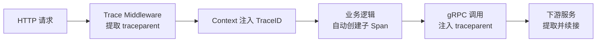

# 链路追踪插件

go-wind-plugins 提供分布式链路追踪适配器，遵循 OpenTelemetry 标准。追踪家族只有 **OTLP 一个插件**：所有主流后端通过 OTLP endpoint 接入，无需更换插件。

## 一、Tracer 接口

```go
type Tracer interface {
    StartSpan(ctx context.Context, name string, opts ...SpanOption) (context.Context, Span)
    Inject(ctx context.Context, carrier propagator.TextMapCarrier)
    Extract(ctx context.Context, carrier propagator.TextMapCarrier) context.Context
    Close(ctx context.Context) error
}

type Span interface {
    End()
    SetAttributes(kv ...KeyValue)
    AddEvent(name string, ...EventOption)
    RecordError(err error)
    SetStatus(code StatusCode, msg string)
}
```

## 二、适配器列表

| 适配器 | 导入路径 | 后端 |
|--------|---------|------|
| OTLP | `plugins/tracer/otlp` | OpenTelemetry Protocol（通用） |

OTLP 是 OpenTelemetry 的标准协议，支持对接所有主流后端：Jaeger、Zipkin、SkyWalking、Tempo (Grafana)、Datadog、阿里云 ARMS、腾讯云 APM 等。只需配置 endpoint 即可切换后端，无需更换插件。

## 三、OTLP（推荐）

```go
import "github.com/tx7do/go-wind-plugins/tracer/otlp"

// 返回原生 *sdktrace.TracerProvider，并设置全局 TracerProvider 与 W3C 传播器
tp, _ := otlp.New(
    otlp.WithEndpoint("localhost:4317"),
    otlp.WithServiceName("my-service"),
    otlp.WithSampleRatio(1.0),
    // otlp.WithHTTP(),                 // 改用 OTLP HTTP 导出
    // otlp.WithServiceVersion("v1.0.0"),
    // otlp.WithHeaders(map[string]string{"authorization": "..."}),
)
defer tp.Shutdown(context.Background())

// 初始化后使用标准 OpenTelemetry API
tracer := tp.Tracer("my-service")
```

### YAML 配置

```yaml
tracer:
  otlp:
    endpoint: "localhost:4317"        # OTLP gRPC endpoint
    insecure: true
    sample_ratio: 1.0                 # 采样率 (0~1)
    service_name: my-service
    resource:
      deployment.environment: production
      host.name: ${HOSTNAME}
```

## 四、后端对接（Jaeger / Zipkin / SkyWalking 等）

没有独立的 Jaeger / Zipkin 插件——它们作为 OTLP 的下游接入：

```yaml
# Jaeger（原生 OTLP，默认端口 4317）
tracer:
  otlp:
    endpoint: "jaeger:4317"

# Grafana Tempo
tracer:
  otlp:
    endpoint: "tempo:4317"
```

SkyWalking、阿里云 ARMS、腾讯云 APM 等支持 OTLP 接入的后端同理，只需替换 endpoint（必要时配合 `headers` 传递鉴权信息）。

## 五、在代码中使用

### 5.1 创建 Span

```go
import "github.com/tx7do/go-wind/tracer"

func handleOrder(ctx context.Context, order *Order) error {
    ctx, span := tracer.StartSpan(ctx, "handleOrder")
    defer span.End()

    span.SetAttributes(
        tracer.String("order.id", order.ID),
        tracer.Int("item.count", len(order.Items)),
    )

    if err := validate(ctx, order); err != nil {
        span.RecordError(err)
        span.SetStatus(tracer.StatusError, err.Error())
        return err
    }

    return nil
}
```

### 5.2 跨服务传播

追踪信息自动通过 HTTP Header / gRPC Metadata 传播：

```go
// HTTP：自动注入 traceparent Header
// gRPC：自动注入 x-trace-* Metadata
// 调用其他服务时无需手动传播
```

### 5.3 添加事件

```go
ctx, span := tracer.StartSpan(ctx, "process-payment")
defer span.End()

span.AddEvent("payment.started")
// ... 处理支付
span.AddEvent("payment.completed",
    tracer.String("transaction.id", txID),
)
```

## 六、采样策略

| 策略 | 说明 | 适用场景 |
|------|------|---------|
| `const(1)` | 全采样 | 开发/测试 |
| `probabilistic(0.1)` | 10% 采样 | 生产环境 |
| `ratelimiting(100)` | 100 span/s | 限流采样 |
| `remote` | 动态配置 | 大规模集群 |

## 七、与 Context 集成



TraceID 同时写入 go-wind Context，可在日志中关联：

```go
ctx, span := tracer.StartSpan(ctx, "operation")
traceID := wind.TraceID(ctx)

log.Info("processing", log.String("trace_id", traceID))
// 日志中自动携带 trace_id，可跳转到 Jaeger UI
```

## 相关文档

- [Context 传播](./core-context.md)
- [插件配置系统](./plugins-config.md)
- [指标监控插件](./plugins-metrics.md)
