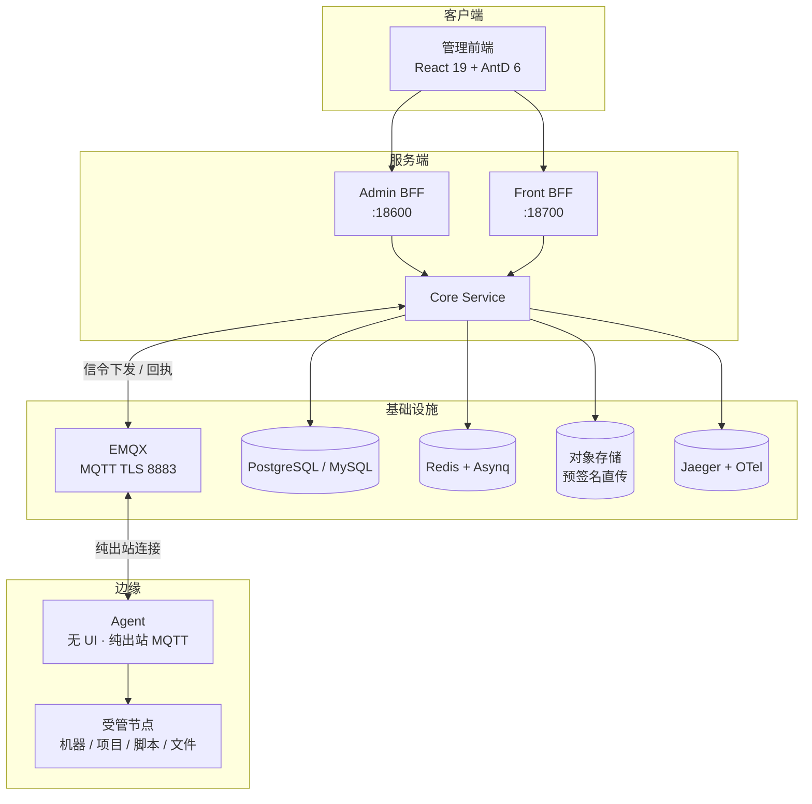

# GoWind Ops 产品介绍

GoWind Ops 是一款开箱即用的多节点运维平台，Go 全栈实现，采用 MIT 协议开源。管机器、跑项目、发脚本、构建分发一站式完成，同时内置组织权限、审计、字典等基座能力，可直接作为企业内部运维中台使用。

> 当前版本：v1.0.0 整理中（Phase 1-10 全部完成） · 开源协议：MIT License · 仓库：[github.com/tx7do/go-wind-ops](https://github.com/tx7do/go-wind-ops)

## 一、产品定位

多机环境下的日常运维，散落在 SSH 终端、脚本目录、定时任务与聊天记录里，难以审计、难以协作。GoWind Ops 把这些动作收敛到一个平台：

- **管机器**：机器指纹准入、心跳指标、在线状态与资源趋势，节点全生命周期可控
- **跑项目**：节点 + 目录 + 启停命令组成项目，启停有据、变更有时间线
- **发脚本**：脚本版本化管理，批量下发多机执行，全过程留痕
- **构建分发**：从源码构建到产物分发灰度，一条流水线编排完成
- **基座内置**：组织权限、审计日志、字典等平台基座能力开箱即用

::: tip
Agent 是边缘代理：无 UI、纯出站 MQTT 连接，只需被管节点能出站访问 EMQX 即可接入，无需在节点上开入站端口。
:::

## 二、核心亮点

- **安全准入**：TOFU 机器指纹准入，配合心跳在线状态，杜绝来路不明的节点
- **全量审计**：指令台账记录回执、退出码、时长与 request_id 幂等；Web 终端会话全量审计 + 只读回放
- **信令可信**：指令信封 HMAC-SHA256 签名，MQTT QoS1 + 幂等去重，TLS 8883 加密传输
- **闭环治理**：告警恢复自动标记 RECOVERY、操作审批（敏感操作先建单）、维护窗口静默
- **多云视角**：阿里云 / 腾讯云 / 华为云 / AWS 账号接入，资源盘点、成本台账、账单入账一屏掌握
- **平台基座**：MFA TOTP + 备份码、OIDC SSO、六类审计 + 哈希链 + ECDSA 签名与核验工具

## 三、功能全景

### 1. 节点与项目

| 功能 | 说明 |
|------|------|
| 节点准入 | TOFU 机器指纹准入；准入 / 吊销 / 恢复 |
| 心跳指标 | 30s 心跳上报指标；在线状态；CPU / 内存 / 磁盘趋势 |
| 项目管理 | 节点 + 目录 + 启停命令组成项目；变更时间线 |
| 指令台账 | 全量审计：回执 / 退出码 / 时长 / request_id 幂等 |
| 运行日志 | WebSocket 实时 tail |

### 2. 终端与文件

| 功能 | 说明 |
|------|------|
| Web 终端 | 基于 xterm.js；会话全量审计 + 只读回放；一次性票据；闲置自动断开 |
| 文件管理器 | 在线编辑；拖拽上传；对象存储预签名直传 |
| 批量命令 | 多机矩阵执行 |
| 批量上传 | 多节点文件批量上传 |

### 3. 脚本与构建分发

| 功能 | 说明 |
|------|------|
| 脚本管理 | 版本化；超时自动杀进程树 |
| 源仓库 | Git 仓库，AES 加密存储 |
| 构建 | 构建产物入对象存储；构建日志实时 tail；产物保留策略 |
| 分发 | zip 防 slip 攻击；分批灰度；DOCKER 镜像 tag 注入 |
| 构建流水线 | BUILD-SCRIPT-DISTRIBUTION 三段编排 |
| 定时任务 | 脚本 / 命令定时执行 |
| 配置中心 | 模板渲染下发；配置漂移检测 |

### 4. 可观测与治理

| 功能 | 说明 |
|------|------|
| 监控告警 | 四类：项目存活 / 节点阈值 / 失联 / 进程守护；恢复自动标记 RECOVERY |
| 通知渠道 | 钉钉、飞书（加签）、企业微信、邮件 |
| 证书台账 | 证书台账与到期告警 |
| 备份恢复 | 备份任务 + 一键恢复到节点 |
| 巡检报告 | 一键聚合；支持定时巡检 |
| 日志快照 | 跨项目检索 |
| 运维大盘 | 全局运维总览 |
| 操作审批 | 敏感操作先建单审批；审批单超时过期 |
| 维护窗口 | 静默期告警抑制 |

### 5. 云管理

| 功能 | 说明 |
|------|------|
| 多云账号 | 阿里云 / 腾讯云 / 华为云 / AWS |
| 资源盘点 | ECS / CVM / EC2 全地域盘点；节点 IP 对账 |
| 成本台账 | 月度趋势；多币种 |
| 账单拉取 | 一键入台账 |
| 预算告警 | 预算与突增检测告警 |

### 6. 平台化

| 功能 | 说明 |
|------|------|
| OpenAPI | API Key 鉴权；构建 / 分发流水线触发端点 |
| Git Webhook | GitHub / GitLab / Gitea webhook 触发 |
| 发布台 | 环境晋升流水线：同一产物按阶段逐环境晋升 |
| 插件指令 | 插件化指令扩展 |
| Agent 升级 | 远程升级，自替换 + 接力重启 |

### 7. 安全基座

| 功能 | 说明 |
|------|------|
| MFA | TOTP + 备份码 |
| SSO | OIDC 单点登录 |
| 会话管理 | 会话查看与踢出 |
| 审计 | 六类审计日志；哈希链 + ECDSA 签名；核验工具 |

## 四、客户端形态

| 端 | 形态 | 说明 |
|------|------|------|
| 管理前端 | Web（React 19 + AntD 6） | 运维人员的唯一操作入口 |
| Agent | 边缘代理（无 UI） | 部署在被管节点，纯出站 MQTT 连接平台 |

## 五、技术架构

### 后端技术栈

| 层次 | 技术 | 说明 |
|------|------|------|
| 语言 | Go 1.26+ | 全栈单语言 |
| 微服务框架 | go-kratos | 四服务架构 |
| 信令通道 | EMQX（MQTT） | 共享订阅 / QoS1 + 幂等 / TLS 8883 / broker 认证回调 |
| 对象存储 | MinIO | 预签名直传 |
| ORM / 数据库 | Ent + PostgreSQL / MySQL | 关系型存储 |
| 任务队列 | Redis + Asynq | 异步任务调度 |
| 指令安全 | 指令信封 HMAC-SHA256 签名 | 防篡改、防重放（幂等） |
| 可观测 | Jaeger + OpenTelemetry | 分布式链路追踪 |

### 系统架构

### 四服务职责

| 服务 | 端口 | 职责 |
|------|------|------|
| Core | 内部 gRPC | 核心业务逻辑与数据层 |
| Admin BFF | :18600 | 管理后台 HTTP API |
| Front BFF | :18700 | 前台 HTTP API |
| Agent | — | 边缘代理，无 UI，纯出站 MQTT 接入 |

> 平台与 Agent 之间通过 EMQX 传递信令：共享订阅横向扩容、QoS1 + 幂等保证至少一次送达且不重复执行、TLS 8883 加密、broker 认证回调对接平台准入。

## 六、界面预览

|  |  |
| :---: | :---: |
| 运维大盘 | 节点管理（机器指纹准入） |

|  |  |
| :---: | :---: |
| 项目管理（启停命令 + 变更时间线） | Web 终端（全量审计 + 只读回放） |

|  |  |
| :---: | :---: |
| 文件管理器（在线编辑 + 预签名直传） | 批量命令（多机矩阵） |

|  |  |
| :---: | :---: |
| 指令台账（全量审计） | 告警记录（四类监控告警） |

|  | |
| :---: | :---: |
| 构建历史（产物 + 日志 tail） | |

## 七、仓库与联系

- **开源仓库**：[github.com/tx7do/go-wind-ops](https://github.com/tx7do/go-wind-ops)
- **快速上手**：[GoWind Ops 快速开始](./quick-start.md)
- **商务联系**：微信 `yang_lin_bo` ｜ 邮箱 <yanglinbo@gmail.com>
