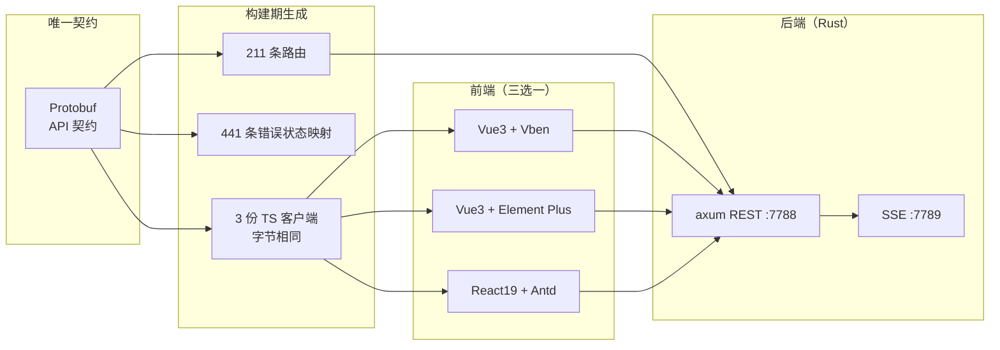

# RushWind Admin 产品介绍

RushWind Admin 是一套**契约驱动的 Rust 企业级管理后台**：Protobuf 是唯一 API 契约，路由、错误映射、TypeScript 客户端全部在构建期确定性生成。它以 Rust 复刻 go-wind-admin 的能力面，定位为「生产就绪基座」，基于 MIT 协议开源。



## 一、核心亮点

| # | 亮点 | 说明 |
|---|------|------|
| 1 | 契约生成链 | 211 条路由、441 条错误状态映射、206 个服务接口零手写；三份 TS 客户端字节相同 |
| 2 | 三套主流前端零改动 | Vue3 Vben / Element Plus、React19 Antd 直接对接，不改一行前端代码 |
| 3 | 多租户 RBAC | 菜单 / 按钮 / 数据五档 / 字段黑名单，四级权限粒度 |
| 4 | 等保 2.0 内建 | 六类审计日志、180 天留存归档（JSONL）、口令三件套、TOTP MFA、AES 口令传输加密 |
| 5 | 认证体系 | JWT RS256 + HttpOnly Cookie refresh token + AK/SK 机器凭证 |
| 6 | 多租户行级隔离 | 读取自动注入租户条件、写入防伪造、默认 fail-closed |
| 7 | 差分回归台架 | 与 Go 参照栈 211 条路由自动 sweep，逐字节比对 |
| 8 | 30+ 功能模块 | 用户 / 租户 / 套餐 / 角色 / 组织 / 菜单 / 字典 / 任务 / 文件 / 通知渠道 / 脚本系统（Lua + JS 热插）/ 六类日志 / Redis 监控等 |
| 9 | 列表导出 | CSV / XLSX 聚合导出，默认上限 1 万行 |
| 10 | 接口文档 | Swagger UI + ReDoc 内建，随服务启动即可访问 |

### 1.1 契约生成链意味着什么

传统开发里，路由注册、错误码表、前端 SDK 是三处各写一遍的重复劳动，也是最容易互相漂移的地方。RushWind Admin 把三者收敛到同一份 Protobuf 契约上：

- **后端路由**：211 条路由在构建期生成，不存在「契约里有、代码里没有」的接口
- **错误映射**：441 条错误状态映射随契约生成，前后端共享同一张错误码表
- **前端客户端**：三套前端各拿到一份 TS 客户端，且三份文件字节相同——契约变了三份同步变，不存在某端漏更

### 1.2 与 Go 参照栈的差分回归

rushwind-toolkit 提供的 Go-Rust 差分台架（testbed）在本项目中落地为常态化的回归手段：以 go-wind-admin 为参照栈，对 211 条路由自动 sweep，逐字节比对两侧响应。Rust 版是否真正对齐 Go 版行为，每次回归都有机器答案。

## 二、界面预览

以下截图来自演示环境，可直观感受整体界面风格。

**登录 / 工作台**

| 登录页（验证码 + 租户编号） | 控制台仪表盘 |
| --- | --- |
|  |  |

**组织与权限**

| 用户管理（组织树 + 高级查询） | 菜单管理 |
| --- | --- |
|  |  |

**审计与会话**

| 操作审计 | 在线用户（强制下线） |
| --- | --- |
|  |  |

**接口文档**

| Swagger UI | ReDoc |
| --- | --- |
|  |  |

## 三、在线体验

无需本地部署，直接访问三端演示站：

| 演示端 | 地址 |
|--------|------|
| Vue Vben 版 | <https://vben.admin.gowind.cloud> |
| Vue Element 版 | <https://ele.admin.gowind.cloud> |
| React 版 | <https://react.admin.gowind.cloud> |
| Swagger 接口文档 | <https://api.demo.admin.gowind.cloud/docs/> |

::: tip
三套前端与 GoWind Admin 演示站共用同一套界面资产，观感一致；差别在后端语言与运行时特性。
:::

## 四、技术栈与本地运行

### 4.1 技术栈

| 维度 | 核心技术 |
|------|---------|
| 语言与框架 | Rust + axum 0.8 |
| ORM | SeaORM |
| 数据库 | PostgreSQL |
| 缓存 | Redis |
| API 契约 | Protobuf（唯一契约，构建期生成路由 / 错误映射 / TS 客户端） |

### 4.2 启动后端

```bash
# 启动 REST(:7788) + SSE(:7789) 两个服务
cargo run -p admin-api
```

### 4.3 启动前端（三选一）

| 前端 | dev 端口 |
|------|---------|
| React | 5888 |
| Element Plus | 5777 |
| Vben | 5666 |

### 4.4 学习路径

仓库 docs/ 提供两份配套资料：

- **8 章渐进教程**：从环境准备到模块二开的完整路径
- **两层文档索引**：先总览后细节，按需深入

::: warning 实现进度说明
部分模块为真实现，其余端点暂为桩实现，以仓库 development-plan.md 进度为准。
:::

## 五、仓库与联系

- GitHub：<https://github.com/tx7do/rushwind-admin>
- 微信：`yang_lin_bo`（添加请备注：公司-姓名-需求）
- 邮箱：<yanglinbo@gmail.com>

## 六、相关文档

- [RushWind 家族总览](./intro.md)
- [GoWind Admin 产品介绍](/admin/intro.md)：Go 参照栈的完整功能文档
