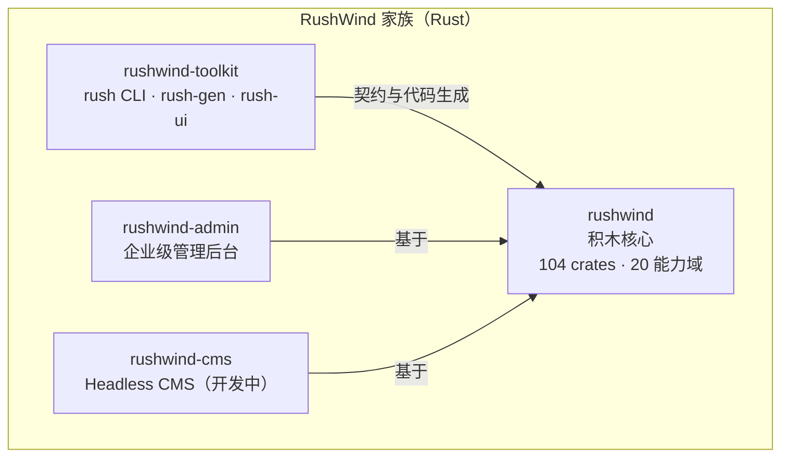

# RushWind（Rust 生态）

RushWind 是 GoWind 研发理念在 **Rust 语言上的实践**：同一套「积木盒框架 + 契约驱动 + 全链代码生成」方法论的第二个实现，面向对**极致性能、内存安全与新协议**（QUIC / WebTransport / HTTP/3）有要求的场景。

RushWind 与 GoWind 是**并列互补**的两条产品线，而非替代关系：Go 侧主打轻量与 AI 生成友好，Rust 侧主打性能与内存安全。两条线共享同一套方法论——核心只做最小编排，一切能力都是可插拔的「积木」；接口契约是唯一事实来源，路由、客户端、文档全部在构建期确定性生成。

## 一、方法论：三个关键词

「积木盒框架 + 契约驱动 + 全链代码生成」这十五个字，是 GoWind 与 RushWind 共同的方法论内核，两侧以各自语言的惯例落地：

| 关键词 | 含义 | RushWind 侧的落地 |
|--------|------|------------------|
| 积木盒框架 | 核心只做最小编排，能力皆可插拔 | rushwind 只做生命周期编排，104 个 crate 按需取用 |
| 契约驱动 | 接口契约是唯一事实来源 | Protobuf 契约，路由 / 错误映射 / TS 客户端构建期生成 |
| 全链代码生成 | 从实体到前端页面的整链生成 | rush CLI 的 `gen entity` / `gen pages` 一次生成三栈 |

方法论同源带来的直接收益是：**两侧的经验可以迁移**。团队在任一侧沉淀的契约设计、权限模型与前端资产，在另一侧同样适用。

## 二、家族四仓

RushWind 家族由四个仓库组成，结构与 GoWind 家族一一对应：

| 仓库 | 角色 | 说明 |
|------|------|------|
| [rushwind](https://github.com/tx7do/rushwind) | 积木核心 | 多服务器生命周期编排 + 全套契约定义；协议栈与存储引擎皆独立 crate |
| [rushwind-toolkit](https://github.com/tx7do/rushwind-toolkit) | 工具箱 | rush CLI + rush-gen 代码生成库 + rush-ui 桌面壳 |
| [rushwind-admin](https://github.com/tx7do/rushwind-admin) | 企业级后台 | 契约驱动的 Rust 管理后台，详见 [RushWind Admin](./admin.md) |
| [rushwind-cms](https://github.com/tx7do/rushwind-cms) | Headless CMS | 开发中：同一契约双面生成 REST + gRPC |

### 1.1 rushwind：积木核心

> 不是全家桶，而是积木盒。

核心只做一件事：**多服务器生命周期编排**——并发启动、级联停机、分阶段限时。其余一切能力都拆为契约与独立 crate，按需取用，协议栈与存储引擎皆不在核心之内。

| 维度 | 现状 |
|------|------|
| crate 规模 | 104 个 crate，20 个能力域全部落地 |
| 内存安全 | 全 workspace `#![forbid(unsafe_code)]`，100% safe code |
| 传输矩阵 | axum / WebSocket / QUIC（quinn）/ WebTransport（wtransport）/ HTTP/3 / MQTT / SSE |
| 存储抽象 | 一套 Repository 契约，适配 12 种存储引擎 |
| 认证 | 8 种认证引擎 |
| 服务注册 | 8 种注册中心引擎 |
| 消息 | 8 种消息引擎 |
| 脚本 | 5 种脚本引擎：Wasm / CEL / Lua / JS / Starlark |
| 质量保障 | testkit 一致性套件，CI 强制合规 |
| 内建文档 | docs/ 含 6 篇专题 + 13 章渐进教程 |

`#![forbid(unsafe_code)]` 是 Rust 编译器的最高级别禁令：整个 workspace 的任何位置都不允许出现 unsafe 代码，安全边界完全交由经过审计的底层库承担。对审计与合规有硬性要求的团队，这一条可以在代码评审之前就把整类风险挡在门外。

::: tip 新协议原生支持
QUIC / WebTransport / HTTP/3 通过 quinn 与 wtransport 作为独立传输 crate 提供，与 axum / WebSocket 走同一套契约接入。需要弱网穿透、低延迟推送或浏览器侧双向流的场景可以直接启用，无需更换架构。
:::

### 1.2 rushwind-toolkit：工具箱

| 组件 | 能力 |
|------|------|
| **rush CLI** | 家族统一命令行入口，子命令见下表 |
| **rush-gen** | 代码生成库：CLI 与自定义流水线共用同一套生成内核 |
| **rush-ui** | Tauri 2 桌面壳：工具链的图形界面形态 |

rush CLI 子命令一览：

| 子命令 | 作用 |
|--------|------|
| `rush adopt` | 下游接管：将已有工程纳入 RushWind 工程化管理 |
| `rush manifest` | 清单管理：盘点工程的模块与依赖构成 |
| `rush gen entity` | 实体整链生成：从实体定义直达接口、存储与前端 |
| `rush gen pages` | 三栈前端页组：一次生成三套前端可用的页面组 |
| `rush new` | 脚手架：创建新工程 |
| `rush testbed` | Go-Rust 差分台架：与 Go 参照栈做行为比对 |

### 1.3 rushwind-admin：企业级后台

契约驱动的 Rust 企业级管理后台，能力面与 go-wind-admin 对齐：

- **契约驱动**：Protobuf 是唯一 API 契约，211 条路由全部构建期生成、零手写
- **三套前端零改动**：Vue3 Vben / Element Plus、React19 Antd 直接对接
- **等保 2.0 内建**：六类审计 180 天留存、TOTP MFA、口令三件套
- **在线演示**：已开放可直接体验的演示站

功能全景、界面预览与本地运行方式详见 [RushWind Admin](./admin.md)。

### 1.4 rushwind-cms：Headless CMS（开发中）

- **同一契约双面生成**：REST 与 tonic gRPC 由同一份契约生成，覆盖 38 个领域服务
- **三服务拓扑**：core 内敛 + 双 BFF 薄代理
- **五前端零改动**：沿用家族统一的前端资产
- **E2E 44 项断言全绿**
- **当前状态**：早期快速演进中，接口与结构可能继续调整

## 三、与 GoWind 的关系

RushWind 不是另行构思的一套体系，而是 GoWind 研发理念在 Rust 上的同构实现，四个仓库一一对应：

| 层 | GoWind（Go） | RushWind（Rust） |
|----|--------------|------------------|
| 积木核心 | go-wind + go-wind-plugins | rushwind |
| 工具链 | go-wind-toolkit | rushwind-toolkit |
| 企业级后台 | go-wind-admin | rushwind-admin |
| Headless CMS | go-wind-cms | rushwind-cms |

仓库命名即是对应关系：把前缀 `go-wind` 换成 `rushwind`，家族地图完全一致。

这种对应不止于结构，也落实在质量口径上：

- **差分回归**：rushwind-admin 以 Go 参照栈为基准，对 211 条路由做自动 sweep，并对 93 条 HEAD 请求做逐字节差分回归——两侧行为是否一致，由机器验证而非口头承诺
- **前端资产同源**：RushWind 系的前端仓同为 GoWind 系前端的快照，界面、交互与权限模型保持一致

对团队而言，这意味着：已经使用 GoWind 的团队可以按需把性能敏感的服务迁移或并行部署到 Rust 侧，契约与前端资产保持通用；从 RushWind 进入的团队，也可以按同一思路把交付效率敏感的部分交给 Go 侧。

## 四、如何选

两条产品线面向不同的优先级，按团队当下的诉求选择即可：

| 你的诉求 | 建议 |
|---------|------|
| 需要 AI 辅助生成提效、快速交付业务系统 | 选 GoWind |
| 需要极致性能、内存安全，或需要 QUIC / WebTransport 等新协议 | 选 RushWind |
| 契约与前端资产 | 两者共享同一套契约与前端资产思路，可按模块混合使用 |

::: tip 两条线也可以混用
契约与前端资产共享，意味着可以 Go 侧交付业务功能、Rust 侧承接性能热点，按服务粒度分工，而非二选一。
:::

::: tip
不确定怎么选？可以先在两侧的演示站各体验一遍后台产品——界面一致，差别在底层语言与运行时特性。
:::

## 五、联系与支持

- 微信：`yang_lin_bo`（添加请备注：公司-姓名-需求）
- 邮箱：<yanglinbo@gmail.com>
- GitHub 组织：<https://github.com/tx7do>

## 六、相关文档

- [RushWind Admin](./admin.md)：家族旗舰产品，契约驱动的 Rust 企业级后台
- [GoWind 框架](/framework/intro.md)：同一方法论在 Go 侧的实现
- [GoWind Toolkit](/toolkit/intro.md)：Go 侧工具链，与 rush CLI 对照阅读更有收获
