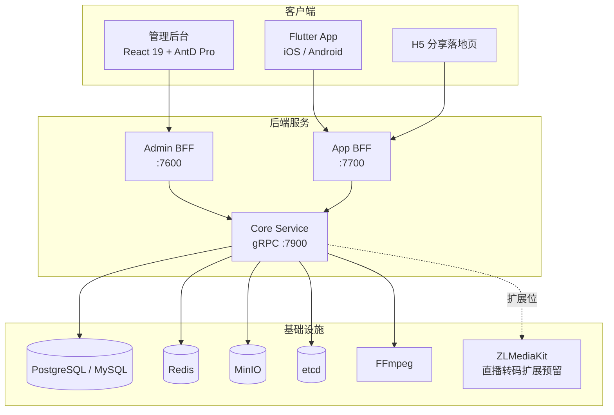

# GoWind ShortPlay（风印短剧）产品介绍

GoWind ShortPlay（风印短剧）是一款基于 GoWind 生态打造的开源企业级短视频/短剧社区基础版（MVP），采用 MIT 协议开源。覆盖上下滑沉浸式视频流、拍摄发布、互动社区与后台审核的完整业务闭环，开箱即用，小流量的企业内部场景可以直接上线运行。

> 当前版本：v0.1.0（2026-10-17 首发） · 开源协议：MIT License · 仓库：[github.com/tx7do/go-wind-shortplay](https://github.com/tx7do/go-wind-shortplay)

## 一、产品定位

短视频/短剧业务的门槛在"闭环"而非"单点"：上传、审核、分发、互动、运营缺一不可。GoWind ShortPlay 把这条链路中最基础的部分做成了可自部署的完整产品：

- **开箱即用**：从上传发布到审核下架、从 Feed 分发到评论弹幕，基础版覆盖完整的业务闭环，部署后即可运营
- **企业内部场景友好**：小流量场景（企业内部短剧、宣发、培训社区）可直接上线，无需自建流媒体团队
- **GoWind 生态一致**：基于 go-wind-cms 基座裁剪而来，与 GoWind Admin / CMS 共享组织权限、审计、字典等基座能力
- **契约边界清晰**：开源版与商业增值包的边界在 API 契约层面已划定，后续升级不破坏二开代码

::: tip
开源版定位是"基础版 MVP"。多码率转码集群、AI 推荐、内容安全审核、SaaS 多租户、直播与付费等能力归入商业增值包，详见[商业增值边界说明](#六-商业增值边界说明)。
:::

## 二、核心亮点

- **沉浸式体验**：上下滑沉浸式视频流，三路召回（关注最新 + 热门加权 + 最新兜底）、已看去重、"不感兴趣"负反馈、断点续播
- **完整审核闭环**：草稿 → 审核 → 发布 / 驳回 / 下架状态机，定时发布与定时下架，后台支持批量审核
- **互动社区齐全**：点赞收藏、关注粉丝、楼中楼评论、弹幕（敏感词过滤 + 举报联动隐藏）、1:1 私信（SSE 实时 + 监管只读）、举报处置闭环
- **追剧体验**：剧集多集容器、选集连播、追剧订阅与追更通知
- **创作者视角**：获赞/粉丝统计、近 7/14/30 日趋势、单视频数据、分享 H5 落地页与分享海报二维码
- **运营后台完备**：数据看板、视频 TOP10、五类审计日志 CSV 导出、用户与权限（角色/菜单/接口/部门权限分组）
- **多语言与青少年模式**：App 与管理后台均支持中/英/日三语，内置青少年模式时长提醒

## 三、功能全景

### 1. 视频与 Feed

| 功能 | 说明 |
|------|------|
| 上传 | 分片上传、断点续传；FFmpeg 自动抽帧生成封面；草稿箱 |
| 状态机 | 草稿 → 审核 → 发布 / 驳回 / 下架；支持定时发布与定时下架 |
| 沉浸式 Feed | 上下滑三路召回：关注最新 + 热门加权 + 最新兜底；已看去重；"不感兴趣"负反馈 |
| 续播 | 断点续播，恢复播放进度 |
| 剧集 | 多集容器、选集连播、追剧订阅、追更通知 |
| 搜索 | 标题模糊 + 标签精确；真实热搜词、搜索联想、本地搜索历史 |
| 标签 | 标签聚合页 |

### 2. 互动社区

| 功能 | 说明 |
|------|------|
| 点赞收藏 | 视频点赞与收藏 |
| 关注 | 关注 / 粉丝体系与个人主页 |
| 评论 | 楼中楼评论，支持作者置顶 |
| 弹幕 | 时间轴弹幕；敏感词过滤；举报联动隐藏 |
| 私信 | 1:1 私信，SSE 实时推送、未读角标；监管端只读查看 |
| 通知 | 站内信 + SSE 实时通知 |
| 举报 | 举报闭环处置：视频下架、评论删除、弹幕隐藏 |
| 行为埋点 | UBA 埋点：观看、完播、划走 |

### 3. 创作者

- **数据统计**：作品获赞、粉丝统计，近 7/14/30 日趋势，单视频数据分析
- **分享**：H5 分享落地页；分享海报（含二维码）

### 4. 运营管理后台

| 功能 | 说明 |
|------|------|
| 视频审核 | 单条与批量审核 |
| 评论管理 | 评论查询与处置 |
| 举报工单 | 举报工单流转与闭环处置 |
| 弹幕管理 | 弹幕查询与隐藏 |
| 私信监管 | 监管只读查看 |
| 审计日志 | 五类审计日志，支持 CSV 导出 |
| 用户与权限 | 角色、菜单、接口、部门权限分组 |
| 数据看板 | 核心指标 + 视频 TOP10 + 近 7 日趋势 |
| 系统配置 | 上传限制、人工审核开关、注册开关、敏感词库、弹幕/私信开关、公告位 |

### 5. 多语言与青少年模式

- **多语言**：App 支持中/英/日，管理后台支持中/英/日
- **青少年模式**：内置使用时长提醒

## 四、界面预览

管理后台（React 19 + AntD Pro）：

|  |  |
| :---: | :---: |
| 后台数据看板（暗色主题） | 后台登录页 |

|  |  |
| :---: | :---: |
| 视频管理（审核状态机） | 举报工单 |

移动端 App（Flutter）：

|  |  |
| :---: | :---: |
| 上下滑沉浸 Feed | 拍摄发布页 |

|  |  |
| :---: | :---: |
| 我的页（创作者数据） | 设置（多语言 / 青少年模式） |

## 五、技术架构

### 1. 客户端形态

| 端 | 技术 | 说明 |
|------|------|------|
| 管理后台 | React 19 + Ant Design Pro + Vite | 运营 / 审核 / 系统管理后台 |
| 移动 App | Flutter 3 + BLoC + media_kit | iOS / Android 双端 |
| 分享落地页 | H5 | 分享海报二维码落地 |

### 2. 后端技术栈

| 层次 | 技术 | 说明 |
|------|------|------|
| 语言 | Go 1.26+ | 高性能编译型语言 |
| 微服务框架 | go-kratos v2.9 | 三服务架构 |
| ORM | Ent | Go 实体框架 |
| 数据库 | PostgreSQL / MySQL | 关系型存储 |
| 缓存 | Redis | 缓存与会话 |
| 对象存储 | MinIO | 视频与封面存储 |
| 媒体处理 | FFmpeg | 抽帧封面等媒体处理 |
| 流媒体 | ZLMediaKit | 预留直播转码扩展 |
| API 契约 | Protobuf 契约优先 + OpenAPI | 接口契约先行 |
| 认证 | JWT | 双端认证 |

### 3. 系统架构

### 4. 三服务职责

| 服务 | 端口 | 职责 |
|------|------|------|
| Admin BFF | :7600 | 管理后台 HTTP API，对接管理前端 |
| App BFF | :7700 | 前台 HTTP API，对接 Flutter App 与 H5 |
| Core | gRPC :7900 | 核心业务逻辑与数据层 |

> Admin BFF 与 App BFF 接收 HTTP 请求后通过 gRPC 调用 Core 服务完成业务处理，接口与业务逻辑解耦。

### 5. 预置角色

| 角色 | 说明 |
|------|------|
| platform:admin | 平台管理员 |
| 租户管理员 | 租户内管理与审核 |
| appuser | App 端普通用户 |

::: tip
GoWind ShortPlay 基于 [go-wind-cms](/cms/intro.md) 基座裁剪而来，组织权限、审计日志、字典等基座能力与 GoWind CMS / Admin 一脉相承，二开经验可直接复用。
:::

## 六、商业增值边界说明

开源版（MIT）与商业增值包的边界在 API 契约层面已经划定，开源版可独立运行，不依赖增值包：

| 能力 | 开源基础版 | 商业增值包 |
|------|:---------:|:---------:|
| 视频上传 / 状态机 / Feed / 互动社区 / 运营后台 | ✅ | — |
| 多码率转码集群 | ❌ | ✅ |
| AI 推荐 | ❌ | ✅ |
| 内容安全审核 | ❌ | ✅ |
| SaaS 多租户 | ❌ | ✅ |
| 直播与付费 | ❌ | ✅（ZLMediaKit 已预留扩展位） |

增值能力按既定契约接入，不影响基于开源版的二开代码。

## 七、仓库与联系

- **开源仓库**：[github.com/tx7do/go-wind-shortplay](https://github.com/tx7do/go-wind-shortplay)
- **仓库文档**：`docs/` 目录提供 `API.md`（接口文档）与 `ROADMAP.md`(产品路线图)
- **快速上手**：[GoWind ShortPlay 快速开始](./quick-start.md)
- **商务联系**：微信 `yang_lin_bo` ｜ 邮箱 <yanglinbo@gmail.com>
