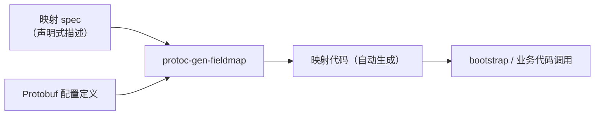

# protoc-gen-fieldmap 字段映射生成器

`protoc-gen-fieldmap` 是 GoWind Toolkit 内置的 7 个 protoc 插件之一，用于**声明式生成"配置字段 → 上游库选项"的映射代码**，并借助 CI 机制防止映射漂移。go-wind-bootstrap 的配置面已全量由它生成。

## 一、解决什么问题

在"声明式配置 + 功能选项模式"的架构里，存在一类典型的胶水代码：

- 配置面上有一个字段（例如超时时间、连接池大小）
- 上游库的功能选项是另一个形态（例如 `WithTimeout(...)`、`WithPoolSize(...)`）
- 中间需要一段手工编写的映射代码，把配置值翻译成选项调用

这类映射代码全靠手工维护时，问题很明显：

| 问题 | 表现 |
|------|------|
| **易漂移** | 上游库新增字段、重命名选项后，映射代码没有同步更新，配置静默失效 |
| **重复劳动** | 每接一个新插件，就要重写一轮"读配置 → 调选项"的样板代码 |
| **难以审查** | 映射散落在各处手写代码里，Code Review 很难确认"每个配置字段都有归宿" |

`protoc-gen-fieldmap` 的思路是：**把映射关系本身声明出来，让代码生成器去写胶水代码**，再用 CI 保证声明与生成结果永远一致。

## 二、工作方式

整体流程分三步：

### 2.1 声明 spec

开发者以**声明式 spec** 描述映射关系：哪个配置字段、对应上游库的哪个选项、默认值如何处理。spec 描述的是"映射意图"而非实现代码——具体如何从配置对象取值、如何调用选项函数，全部由生成器完成。

### 2.2 生成映射函数

执行 protoc 时，插件按 spec 生成一组命名规范的映射函数。命名遵循 bootstrap 维护手册的约定，形如：

| 生成函数 | 职责 |
|----------|------|
| `Map<Name>Options` | 将配置对象转换为上游库的功能选项列表 |
| `New<Name>Config` | 由配置对象构造上游库的配置实例 |
| `Fill<Name>Config` | 向一个已存在的上游配置实例填充字段 |

其中 `<Name>` 为映射目标的名称，随配置对象一一对应。业务与装配层代码只依赖这些生成的函数，不再手写任何字段搬运逻辑。

### 2.3 接入方式

`protoc-gen-fieldmap` 与其他 protoc 插件一样，通过 protoc 的插件机制调用，可纳入项目的常规代码生成流程（如 Makefile 脚本或 `gow` 的生成命令链），生成结果随源码一并提交。

## 三、未提及字段告警

生成过程中，插件会检查配置对象中的字段是否都被 spec 覆盖：

- **spec 未提及的字段**会在生成时产生告警，提示维护者"这个字段还没有映射归宿"
- 维护者据此决定：补上映射，或在 spec 中显式声明忽略

这从机制上消灭了"新增配置字段后忘了接线"这一类静默缺陷——漏配在生成阶段就被暴露，而不是等到运行时才发现配置不生效。

## 四、CI 防漂移

仅靠人工记得重新生成还不够，GoWind 在 CI 中加了机械化兜底：

1. CI 按 spec **重新执行一次生成**
2. 将生成结果与仓库中已提交的代码做**逐字节比对**
3. 任何不一致都直接判 CI 失败

这个检查防住两类漂移：

| 漂移场景 | CI 反应 |
|----------|---------|
| 改了 spec，忘记执行生成 | 重新生成结果与已提交代码不一致，CI 失败 |
| 有人绕过生成器，手改了生成代码 | 手改内容无法从 spec 再生出来，比对失败 |

也就是说：**生成代码永远与 spec 保持字节级一致**，spec 成为映射关系的唯一事实来源（Single Source of Truth）。

## 五、与 go-wind-bootstrap 的关系

go-wind-bootstrap 是 `protoc-gen-fieldmap` 最大的受益者，也是生成函数命名约定的来源：

- Bootstrap 按 family（服务器、日志、数据库、缓存等）组织配置面，每个 family 都要把 YAML 配置装配成对应插件的功能选项
- 这些字段映射**已全量由 `protoc-gen-fieldmap` 生成**，bootstrap 侧不再手工维护映射代码
- 上游插件库（go-wind-plugins）选项演进时，只需更新 spec 重新生成，CI 防漂移检查保证 bootstrap 配置面不会悄悄落后

详见 [go-wind-bootstrap 声明式启动器](/framework/bootstrap-intro.md) 中的「字段映射代码生成」一节。

## 六、使用建议

- **插件/中间件作者**：如果您的库采用功能选项模式，又需要对接声明式配置，可直接用 spec 声明映射并生成代码，省去样板胶水
- **业务项目**：项目中"配置结构体 → 第三方客户端选项"的重复转换代码，同样可以用它收敛为一份 spec
- **升级策略**：上游库变更时先改 spec、再重新生成、最后跑 CI 比对，三步闭环替代手工排查

## 相关文档

- [GoWind Toolkit 介绍](/toolkit/intro.md)（protoc 插件清单）
- [go-wind-bootstrap 声明式启动器](/framework/bootstrap-intro.md)
- [后端代码生成](/toolkit/backend-code-generation.md)
