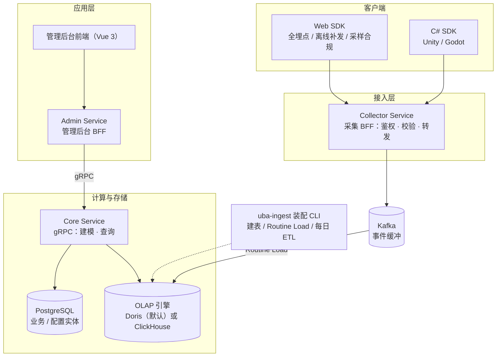

# GoWind UBA 产品介绍

**GoWind UBA**（User Behavior Analytics，中文名「风行用户行为分析平台」）是一款基于 **Go（go-kratos 微服务框架）+ Vue 3 + ClickHouse/Doris 双引擎 OLAP** 的多租户用户行为分析系统，**v1.0.0 已正式首发**。

- **25+ 分析模型**：通用分析 10 + 用户深度洞察 9 + 游戏专项 6
- **增长闭环**：覆盖「采集 → 分析 → 存档 → 触达」全链路，内置 AI 助手
- **双引擎 OLAP**：Apache Doris（默认）/ ClickHouse 二选一，共用同一份业务模型
- **多端 SDK**：Web SDK（全埋点/离线补发/采样合规）+ C# SDK（Unity/Godot）
- **开源免费**：MIT 协议

> 让每一次用户行为都有迹可循，让每一份数据洞察触手可及。

本页是全部 UBA 文档的入口。无论你是二次开发者、运维人员还是数据分析师，都建议先读本页的「读者导航」，找到适合你的阅读路径。

---

## 一、什么是 UBA

UBA（User Behavior Analysis）是一种用于收集、分析和报告用户在网站、App、游戏等数字产品上行为的数据分析技术。它帮助企业了解用户的偏好、习惯与行为模式，从而优化产品体验、提升转化率、实现精准营销，并识别潜在的业务与安全风险。

GoWind UBA 的核心数据链路是一条经典的流式数仓管道：

```
客户端 SDK  →  Collector（采集）  →  Kafka（缓冲）  →  OLAP 引擎（Doris / ClickHouse，Routine Load 消费落库）

管理后台  →  Admin Service（BFF）  →  Core（gRPC：建模 / 查询）  →  OLAP 引擎 + PostgreSQL（业务实体）

uba-ingest（装配 CLI）→ 建表 / Routine Load 装配 / 每日 ETL（支持日内循环）
```

> 写入路径上 **Core 默认不经手事件入库**——Collector 把事件发到 Kafka 后，由 Doris Routine Load 直接落库；Core 负责读侧的建模与查询。详见 [系统架构](./architecture.md)。

---

## 二、功能全景

### 25+ 分析模型

`AnalyticsService` 提供 25+ 个分析模型，按场景分为三组：**通用分析 10 个、用户深度洞察 9 个、游戏专项 6 个**，覆盖事件趋势、活跃用户、漏斗、留存、转化路径、用户分群、营收/LTV、关卡分析、滚服留存、同时在线（PCU/ACU）、经济系统等场景。

文档站为每个模型提供了独立专页（含口径说明与操作指引），入口见 [数据分析师上手指南](/uba/analyst-getting-started.md)。

### 增长闭环

围绕「采集 → 分析 → 存档 → 触达」，UBA 提供成套的闭环能力：

| 能力 | 说明 |
|------|------|
| 持久化分群 | 用户分群持久保存，供下游分析与触达复用 |
| 自定义看板 | 自由组合图表，搭建专属看板 |
| 阈值告警 | 指标越过阈值即触发告警 |
| 定时报告 | 按计划生成并推送分析报告 |
| 功能开关与 AB 实验 | 功能开关控制 + A/B 实验对比 |
| 营销触达 | 面向分群用户的营销触达 |
| 自助 SQL | 直接编写 SQL 查询 OLAP 数据 |
| 用户 360 | 单用户全维度行为档案 |
| ID-Mapping | 多端多源身份打通 |
| 动态标签 | 基于规则自动维护用户标签 |
| 可视化埋点 | 无需改代码的埋点配置 |
| rrweb 会话回放 | 基于 rrweb 的用户会话回放 |

### 实时大屏与导出

- **实时大屏**：基于 SSE 推送，支持双模式展示；
- **服务端全量导出**：XLSX / CSV 两种格式，覆盖 7 类资源。

### 日内循环 ETL

`uba-ingest` 支持日内循环 ETL（`--loop --every`），白天也能看到当天数据，不必等到次日。

### 通知域

| 能力 | 说明 |
|------|------|
| 多通道 | 站内信 / 邮件 / SMS / Webhook |
| 事件路由 | 按事件配置路由规则 |
| 消息模板 | 通知内容模板化 |
| 发送台账 | 全量发送记录可查 |

### 风险引擎

风险规则配置与风险事件管理，上报通道支持行为事件与风险事件混合上报，识别异常行为。

### AI 模块

| 能力 | 说明 |
|------|------|
| 对话 | AI 对话助手 |
| RAG | 知识检索增强问答 |
| 智能问数 | NL2SQL 自然语言查数，只读执行 |
| 问数审计 | 智能问数的执行审计记录 |
| 报表 AI 摘要 | 报表自动生成 AI 摘要 |
| 租户 token 配额 | 按租户控制 AI token 用量 |

---

## 三、系统架构



### 服务组成

| 服务 | 定位 | 职责 |
|------|------|------|
| admin-service | 管理后台 BFF | 承载管理后台 HTTP API 与 SSE 推送 |
| collector-service | 采集 BFF | 接收 SDK 上报，应用鉴权、字段校验与补全，转发 Kafka；无状态，可水平扩展 |
| core-service | 核心服务 | 分析建模、查询、分群、标签、通知、AI 等重业务逻辑 |
| uba-ingest | 装配 CLI | 建表、配置 Routine Load、每日 ETL（支持 `--loop --every` 日内循环） |

### 数据采集 SDK

| SDK | 适用平台 | 特性 |
|-----|---------|------|
| Web SDK（TypeScript） | 浏览器 / Node | 全埋点、离线补发、采样合规 |
| C# SDK（.NET Standard 2.0） | Unity（原生 + WebGL）/ Godot 4 / .NET | 游戏专属维度 `serverId` / `level` |

---

## 四、界面预览

| 分析仪表盘 | 事件分析 |
| :---: | :---: |
|  |  |

---

## 五、部署与体验

- **Docker Compose 一键部署**：OLAP 引擎默认使用 Doris（FE/BE），ClickHouse 二选一切换，详见 [Docker 部署](./deploy-docker.md)
- **数据装填**：Kafka + Routine Load 消费落库，由 `uba-ingest` 完成装配
- **可选 BI**：Apache Superset 容器直连引擎，基于事实表搭建仪表板，详见 [Superset 部署](./deploy-superset.md)
- **演示数据**：仓库内提供 `sql/postgresql/demo-data.sql`，导入后即可获得开箱可分析的数据

::: tip 关于在线演示
UBA 暂无公网演示站点。本地体验路径：按 [Docker 部署](./deploy-docker.md) 拉起三服务与依赖组件，导入演示数据 `sql/postgresql/demo-data.sql`，即可登录管理后台开始分析。

商务合作与技术支持微信：`yang_lin_bo`
:::

---

## 六、读者导航

本套文档**按角色分栏**组织。请根据你的身份选择阅读路径：

### 二次开发者

关心「如何在 UBA 上做二次开发、加接口、加页面、加实体」。

1. 先读 [安装指南](./installation.md) 把三服务跑起来
2. 读 [系统架构](./architecture.md) 和 [后端模块总览](./backend-modules.md) 建立全局观
3. 读 [后端 API 契约](./backend-api.md) 理解 proto 优先的开发模式
4. 跟着教程动手：[代码生成管线](./tutorial-codegen.md)、[新增对外服务](./tutorial-new-service.md)、[新增业务实体](./tutorial-new-entity.md)、[新增前端页面](./tutorial-new-page.md)
5. 接 SDK 时读 [Web SDK 接入](./sdk-web.md) / [C# SDK 接入](./sdk-csharp.md)

### 运维人员

关心「如何部署、配置、监控、保障稳定」。

1. 读 [系统架构](./architecture.md) 了解三服务与依赖
2. 部署：[Docker 部署](./deploy-docker.md)、[配置详解](./deploy-config.md)（**含默认口令/密钥安全清单，务必轮换**）、[PM2 部署](./deploy-pm2.md)
3. BI 对接：[Superset 部署](./deploy-superset.md)
4. 故障排查与端口对照：[附录](./appendix.md)

### 数据分析师

关心「数据从哪来、存在哪、怎么查、怎么分析」。

1. 读 [数据分析师上手指南](/uba/analyst-getting-started.md)（含 25 个分析模型专页入口与 OLAP 表字段地图）
2. 掌握核心分析能力：[事件趋势分析](./analyst-event-trend.md)、[漏斗分析](./analyst-funnel.md)、[留存分析](./analyst-retention.md)
3. 进阶查询：[OLAP 查询手册](./analyst-olap-cookbook.md)
4. 与 BI 协作：[Superset 部署](./deploy-superset.md)

---

## 七、相关文档与获取帮助

- 项目源码与 README：[go-wind-uba](https://github.com/tx7do/go-wind-uba)
- 反馈与提问：[GitHub Issues](https://github.com/tx7do/go-wind-uba/issues)
- 技术基座：[GoWind Admin 文档](/admin/intro.md)（UBA 与 Admin/CMS 共享同一套 go-kratos + Ent + 权限基座）
- 通用指南：[快速开始](/guide/getting-started.md)
- 商务合作与技术支持微信：`yang_lin_bo`
- 商务合作与技术支持邮箱：<yanglinbo@gmail.com>
- 开源协议：**MIT**
